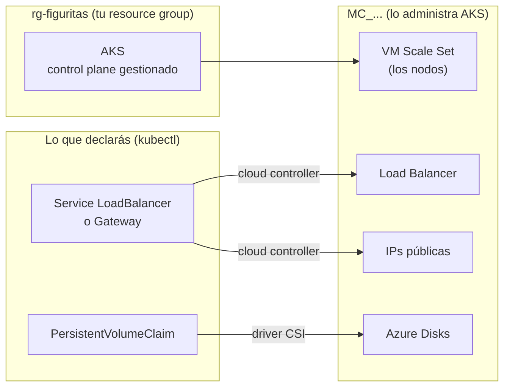

# Kubernetes en la nube: cluster AKS

## Objetivo

Pasar de Minikube a un cluster **gestionado** en Azure (AKS): el mismo Kubernetes, pero el control
plane lo opera Azure y, cuando le pedís algo que no existe adentro del cluster (una IP pública, un
disco), la nube lo crea por vos.

La guía va paso a paso y termina con dos scripts, `up.sh` y `down.sh`, que hacen todo esto en un
comando. **Ese es el cluster que van a usar para el TP**: lo levantan cuando trabajan y lo destruyen
cuando terminan.

Al final de la guía vas a poder:

- Crear un cluster AKS a mano (`az`) y entender cada pieza.
- Ver qué parte del cluster es tuya y qué parte administra Azure.
- Exponer servicios con una IP pública, persistir datos en discos de Azure y usar ConfigMaps y Secrets.
- Aislar tráfico con NetworkPolicy y poner un único punto de entrada con Gateway API.
- Levantar y destruir el cluster del TP con `./up.sh` y `./down.sh`.

**Duración estimada:** ~1 h 45 min, de los cuales ~35 son esperar que Azure cree y borre cosas (buen momento para leer los manifests).

---

## ⚠️ Antes de empezar: el cluster cuesta plata

Azure for Students da **US$100 de crédito**. Mientras el cluster exista se cobran los nodos (VMs), las IPs
públicas, el balanceador y los discos, **aunque no lo estés usando**. El control plane, en el tier
Free, no se cobra.

Orden de magnitud (precios de lista, octubre 2026): el cluster de esta guía cuesta **~US$0,30 por
hora**. Hacer la guía completa sale menos de US$1; **olvidárselo prendido un fin de semana son ~US$18**,
y un mes entero se come todo el crédito.

El hábito para toda la cursada: **lo levantás, trabajás, lo destruís.** Todo lo que necesites tiene que
estar en el repo (manifests, scripts), porque el cluster no sobrevive de un día para el otro. El
consumo lo ves en el portal (con un día de demora): **Education → Overview → View cost details**.

---

## Pre-requisitos

- Terminal Linux, macOS o **WSL2**. En WSL: trabajá dentro de `/home/...` (no en `/mnt/c/...`) e
  instalá **todas** las herramientas adentro de WSL. Si usás el `az` o el `kubectl` de Windows, el
  kubeconfig termina en `C:\Users\...` y el `kubectl` de WSL no lo ve.
- Cuenta de **Azure for Students** activa: <https://azure.microsoft.com/free/students> (con el mail del ITBA).
- Herramientas:

| Herramienta | Instalación | Verificación |
|---|---|---|
| Azure CLI | <https://learn.microsoft.com/cli/azure/install-azure-cli> | `az version` |
| Terraform ≥ 1.6 | <https://developer.hashicorp.com/terraform/install> | `terraform version` |
| kubectl ≥ 1.35 | `az aks install-cli`, o el de la clase anterior si es reciente | `kubectl version --client` |
| Helm 3 | <https://helm.sh/docs/intro/install/> | `helm version` |
| git, curl, openssl | vienen en casi cualquier Linux/macOS | — |

> El cluster sale con Kubernetes 1.36, y `kubectl` se soporta hasta una versión menor de distancia.
> Uno de Minikube de hace un año puede andar a medias.

### Bajar el repositorio

Los scripts y manifests de la guía están en el repo de la materia:

```bash
git clone https://gitlab.com/itba-73-40-microservicios/alumnos/2026s2.git
cd 2026s2/guias/k8s-aks
```

**Todos los comandos de la guía se corren desde esta carpeta.**

---

## Parte 1: Cuenta y permisos (~15 min)

### 1.1 Login

```bash
az login
az account show --query "{suscripcion:name, estado:state}" -o table
```

Tiene que aparecer la suscripción **Azure for Students** en estado `Enabled`.

### 1.2 Registrar los providers

Cada servicio de Azure es un *resource provider* que la suscripción tiene que tener habilitado. En una
cuenta nueva suelen estar sin registrar:

```bash
for p in Microsoft.ContainerService Microsoft.Compute Microsoft.Network Microsoft.Storage; do
  az provider register --namespace "$p" --wait
done
az provider show -n Microsoft.ContainerService --query registrationState -o tsv
```

✅ Esperado: `Registered` (el `--wait` puede tardar un par de minutos la primera vez).

### 1.3 Región y tamaño de VM: los tuyos

Azure for Students pone tres límites, y **los dos primeros cambian de una suscripción a otra**:

1. Una policy que solo deja crear recursos en **cinco regiones**, distintas para cada uno. Mirá las tuyas:

   ```bash
   az policy assignment list --disable-scope-strict-match \
     --query "[].parameters.listOfAllowedLocations.value[]" -o tsv
   ```

2. No todas esas regiones **ofrecen** los mismos tamaños de VM, y algunos están bloqueados para tu
   suscripción (`NotAvailableForSubscription`).
3. **Cuota**: 6 vCPU por región, y solo para algunas familias. Las de VMs chicas y baratas que sirven
   para el cluster son `Bsv2` y `Basv2`:

   ```bash
   az vm list-usage -l <una-de-tus-regiones> -o table | grep -i -E "Total Regional vCPUs|BSv2|BASv2"
   ```

Hay que encontrar una región **permitida** que **ofrezca** `Standard_B2s_v2` (o `Standard_B2as_v2`).
Hacerlo a mano es tedioso, así que hay un script que recorre tus regiones (tarda un par de minutos):

```bash
./elegir-region.sh
```

```
Regiones permitidas: brazilsouth southafricanorth mexicocentral newzealandnorth canadacentral
Revisando cada una (1-2 minutos por región)...
  brazilsouth: no ofrece Standard_B2s_v2 Standard_B2as_v2 con cuota
  southafricanorth: Standard_B2s_v2 disponible ✔

Guardado en terraform/terraform.tfvars (lo usa ./up.sh). Para la parte 2 de la guía:
  export LOCATION=southafricanorth VM_SIZE=Standard_B2s_v2
```

✅ Esperado: una región con ✔. **Copiá y corré la línea `export`**: la parte 2 usa esas variables.

> Que la región quede lejos (Sudáfrica, Nueva Zelanda) no importa para este uso: lo que viaja es el
> tráfico de `kubectl` y algún `curl`, no la comunicación entre tus servicios, que queda adentro del cluster.

---

## Parte 2: Crear el cluster a mano (~10 min)

Primero lo hacemos con `az`, comando por comando, para ver qué pieza crea cada uno. En la parte 9 lo
mismo queda en un script.

### 2.1 Variables

`LOCATION` y `VM_SIZE` ya las exportaste en la parte 1.3. Sumamos los nombres:

```bash
export RG=rg-figuritas
export CLUSTER=aks-figuritas
echo "$LOCATION $VM_SIZE"      # tienen que tener valor
```

> **Si abrís otra terminal**, las variables no viajan. Este bloque las recupera todas (las que todavía
> no existan quedan vacías, no pasa nada):
>
> ```bash
> export RG=rg-figuritas CLUSTER=aks-figuritas
> export LOCATION=$(az group show -n "$RG" --query location -o tsv)
> export NODE_RG=$(az aks show -g "$RG" -n "$CLUSTER" --query nodeResourceGroup -o tsv)
> export IP=$(kubectl -n figuritas get svc web -o jsonpath='{.status.loadBalancer.ingress[0].ip}' 2>/dev/null)
> ```

### 2.2 Resource group

Un *resource group* es una carpeta de recursos de Azure. Borrar el grupo borra todo lo que tiene
adentro, y eso es lo que vamos a hacer al final.

```bash
az group create --name "$RG" --location "$LOCATION" --tags curso=73.40
```

### 2.3 El cluster

```bash
az aks create \
  --resource-group "$RG" \
  --name "$CLUSTER" \
  --tier free \
  --node-count 2 \
  --node-vm-size "$VM_SIZE" \
  --node-osdisk-size 30 \
  --network-plugin azure \
  --network-plugin-mode overlay \
  --network-dataplane cilium \
  --generate-ssh-keys \
  --tags curso=73.40
```

Tarda **5 a 6 minutos**. Mientras espera, qué pide cada flag:

| Flag | Qué significa |
|---|---|
| `--tier free` | Control plane sin costo (y sin SLA). En producción se usa `standard`. |
| `--node-count 2` `--node-vm-size` | Dos VMs como nodos. Son las que consumen crédito. |
| `--network-plugin azure` `--network-plugin-mode overlay` | El CNI: los pods toman IPs de una red propia (*overlay*), separada de la red de las VMs. Es la slide de "Overlay o ruteo nativo". |
| `--network-dataplane cilium` | Cilium (eBPF) mueve los paquetes, **reemplaza a kube-proxy** y hace cumplir las NetworkPolicy. |
| `--generate-ssh-keys` | Crea una clave SSH para los nodos si no tenés una en `~/.ssh`. |

### 2.4 Conectar kubectl

```bash
az aks get-credentials --resource-group "$RG" --name "$CLUSTER" --overwrite-existing
kubectl config current-context
kubectl get nodes -o wide
```

✅ Esperado: el contexto `aks-figuritas` y dos nodos `Ready`. Fijate en las columnas `OS-IMAGE` y
`CONTAINER-RUNTIME`.

> Para volver a Minikube: `kubectl config use-context minikube`. Para volver a AKS:
> `kubectl config use-context aks-figuritas`.

### 2.5 ¿Qué creó Azure?

```bash
az group list -o table
```

Además de `NetworkWatcherRG` (lo crea Azure solo, no cobra), hay **dos** resource groups: el tuyo
(`rg-figuritas`) y uno que empieza con `MC_`. Ese segundo lo administra AKS: ahí viven las VMs de los nodos, la red, el balanceador y, más adelante, las IPs y
los discos que pidan tus manifests. Guardalo en una variable:

```bash
export NODE_RG=$(az aks show -g "$RG" -n "$CLUSTER" --query nodeResourceGroup -o tsv)
az resource list -g "$NODE_RG" --query "[].{nombre:name, tipo:type}" -o table
```

✅ Esperado: un `virtualMachineScaleSets` (los nodos), una `virtualNetworks`, un `loadBalancers`
llamado `kubernetes` y **ya una** `publicIPAddresses`: es la IP por la que tus nodos salen a internet
(por ejemplo, para bajar imágenes). Todavía no expusiste nada.

---

## Parte 3: ¿Dónde está el control plane? (~10 min)

En Minikube, `kube-system` mostraba el apiserver, etcd, el scheduler y el controller-manager como pods.
Acá no.

```bash
kubectl cluster-info
kubectl get pods -n kube-system
```

- La API responde en una URL `*.azmk8s.io`: el **apiserver vive en infraestructura de Azure**, fuera de
  tus nodos.
- En `kube-system` **no hay** `etcd`, `kube-apiserver`, `kube-scheduler` ni `kube-controller-manager`.
  Azure los opera, los actualiza y les hace backup.
- Tampoco hay `kube-proxy`: lo reemplaza Cilium (los pods `cilium-*`).
- Lo que sí hay es lo que conecta el cluster con Azure:
  - `konnectivity-agent`: el túnel por el que el control plane de Azure llega a tus nodos.
  - `cloud-node-manager`: le informa al cluster qué VM de Azure es cada nodo.
  - `csi-azuredisk-node` / `csi-azurefile-node`: los drivers que enganchan discos de Azure a los pods.

Lo que **sí** sigue en tus nodos es lo mismo de siempre. Entrá a uno:

```bash
NODO=$(kubectl get nodes -o jsonpath='{.items[0].metadata.name}')
kubectl debug node/$NODO -it --image=mcr.microsoft.com/cbl-mariner/busybox:2.0
```

Adentro del pod de debug:

```bash
chroot /host                         # pasar al filesystem del nodo
systemctl status kubelet --no-pager | head -5
crictl ps | head                     # los contenedores que corre containerd
exit; exit
```

Borrá el pod de debug que quedó:

```bash
kubectl get pods -o name | grep node-debugger | xargs -r kubectl delete
```

> **Lo que te ahorraste.** En 2026S1 este cluster se armaba a mano sobre VMs con `kubeadm`:
>
> | Con kubeadm (a mano) | En AKS |
> |---|---|
> | `swapoff`, módulos del kernel, `sysctl` | Ya viene en la imagen del nodo |
> | Instalar CRI-O / containerd | containerd preinstalado |
> | `kubeadm init`: apiserver, etcd, scheduler, controller-manager | Control plane gestionado: no lo ves |
> | Instalar Calico | `--network-plugin ... --network-dataplane cilium` |
> | `kubeadm join` en cada worker | `--node-count 2` |
> | `scp` del kubeconfig | `az aks get-credentials` |
>
> El `kubelet` y el runtime siguen ahí: lo que cambió es quién los instala y los mantiene.

---

## Parte 4: Lo que la nube hace por vos (~20 min)

### 4.1 Una IP pública con un Service LoadBalancer

```bash
kubectl apply -f manifests/00-namespace.yaml -f manifests/10-web.yaml -f manifests/11-web-service-lb.yaml
kubectl -n figuritas get svc web -w
```

En Minikube, `EXTERNAL-IP` se quedaba en `<pending>` para siempre. Acá, en unos 30 segundos aparece
una IP. Cortá con `Ctrl+C` y mirá qué apareció en Azure:

```bash
az network public-ip list -g "$NODE_RG" --query "[].{nombre:name, ip:ipAddress}" -o table
```

✅ Esperado: además de la IP de salida que ya estaba, una nueva llamada `kubernetes-<id>` con la misma
IP que muestra el Service.

Kubernetes no "tiene" balanceadores: el **cloud controller** de AKS vio un Service `LoadBalancer`, le
pidió a Azure una IP pública y una regla en el balanceador, y escribió la IP en el Service.

```bash
export IP=$(kubectl -n figuritas get svc web -o jsonpath='{.status.loadBalancer.ingress[0].ip}')
for i in 1 2 3 4 5 6; do curl -s -D- -o /dev/null http://$IP | grep -i servido; done
```

✅ Esperado: en el header `X-Servido-Por` aparecen los nombres de los dos pods de `web` (no
necesariamente alternados: el balanceo es por conexión y al azar). Abrí `http://$IP` en el
navegador: el HTML y la config de nginx salen del ConfigMap `web` (mirá `manifests/10-web.yaml`).

### 4.2 Secret: la password de la base

La password **no** va en un archivo del repo. La creamos directo en el cluster:

```bash
kubectl -n figuritas create secret generic postgres-cred \
  --from-literal=POSTGRES_PASSWORD="$(openssl rand -base64 18)"
```

Y ahora mirá qué tan "secreto" es:

```bash
kubectl -n figuritas get secret postgres-cred -o jsonpath='{.data.POSTGRES_PASSWORD}' | base64 --decode; echo
```

Base64 es una codificación, no cifrado: cualquiera con permiso de leer Secrets en el namespace la ve.
Por eso importan el RBAC y no commitear Secrets.

### 4.3 Un disco de Azure con un PVC

```bash
kubectl get storageclass
```

AKS trae varias StorageClasses: las `managed*` y `default` crean **Azure Disks** (un disco por PVC,
se engancha a un solo nodo: `ReadWriteOnce`); las `azurefile*` crean shares de **Azure Files**, que
varios pods pueden montar a la vez (`ReadWriteMany`). La marcada `(default)` es la que usa un PVC que
no pide ninguna. Fijate en `VOLUMEBINDINGMODE: WaitForFirstConsumer`: el disco no se crea hasta que
hay un pod que lo usa, así nace en la misma zona que el nodo donde cae el pod.

Desplegamos Postgres como StatefulSet (config en ConfigMap, password del Secret):

```bash
kubectl apply -f manifests/20-postgres.yaml
kubectl -n figuritas get pvc,pv -w
```

El PVC arranca `Pending` (el `WaitForFirstConsumer` de recién) y a los pocos segundos pasa a `Bound`.
Cortá y buscá el disco en Azure:

```bash
az disk list -g "$NODE_RG" --query "[].{nombre:name, gb:diskSizeGB, estado:diskState}" -o table
```

✅ Esperado: un disco `pvc-...` de 4 GB en estado `Attached`, el mismo nombre que el PV.

> Mirá el `PGDATA` en `manifests/20-postgres.yaml`: un disco recién formateado trae una carpeta
> `lost+found`, y Postgres no inicializa en un directorio que no está vacío. Por eso los datos van
> en una subcarpeta. Es un clásico la primera vez que se monta un volumen real.

### 4.4 Los datos sobreviven al pod

```bash
kubectl -n figuritas wait --for=condition=Ready pod/postgres-0 --timeout=3m
kubectl -n figuritas exec postgres-0 -- psql -U album -d album -c \
  "CREATE TABLE figuritas(numero int PRIMARY KEY, jugador text);
   INSERT INTO figuritas VALUES (10, 'Messi'), (9, 'Julián Álvarez');"

kubectl -n figuritas delete pod postgres-0
kubectl -n figuritas wait --for=condition=Ready pod/postgres-0 --timeout=3m
kubectl -n figuritas exec postgres-0 -- psql -U album -d album -c "SELECT * FROM figuritas;"
```

✅ Esperado: las dos figuritas siguen ahí. El pod es nuevo, el disco es el mismo: el StatefulSet
vuelve a montar el PVC `data-postgres-0`.

---

## Parte 5: NetworkPolicy (~10 min)

Hoy cualquier pod del cluster puede hablarle a Postgres. Probalo con un pod "intruso":

```bash
kubectl -n figuritas run intruso --rm -it --restart=Never --image=postgres:17 -- pg_isready -h postgres -t 5
```

✅ Esperado: `accepting connections`. Ahora aplicamos tres reglas (leé el archivo):

1. *Default deny*: nadie recibe tráfico salvo que una policy lo permita.
2. La web acepta el puerto 80 desde cualquier lado.
3. Postgres solo acepta pods con la label `acceso-db=true`.

```bash
kubectl apply -f manifests/30-networkpolicies.yaml

# El intruso ya no llega
kubectl -n figuritas run intruso --rm -it --restart=Never --image=postgres:17 -- pg_isready -h postgres -t 5

# Un pod autorizado sí
kubectl -n figuritas run cliente --rm -it --restart=Never --labels=acceso-db=true \
  --image=postgres:17 -- pg_isready -h postgres -t 5

# Y la web sigue pública
IP=$(kubectl -n figuritas get svc web -o jsonpath='{.status.loadBalancer.ingress[0].ip}')
curl -s -o /dev/null -w '%{http_code}\n' http://$IP
```

✅ Esperado: el intruso da `no response`, el cliente `accepting connections` y la web `200`.

Quien hace cumplir estas reglas es Cilium, el dataplane que elegiste en la parte 2. Con un CNI sin
soporte de NetworkPolicy, Kubernetes acepta el objeto y **no pasa nada**.

---

## Parte 6: Un solo punto de entrada con Gateway API (~10 min)

Un Service `LoadBalancer` por cada microservicio es una IP pública (y su costo) por servicio. Lo
habitual es **un** punto de entrada que rutea por path o host. Para eso está Gateway API, pero, como
con las NetworkPolicy, alguien tiene que implementarlo: instalamos **Envoy Gateway**.

```bash
helm upgrade --install eg oci://docker.io/envoyproxy/gateway-helm \
  --version v1.9.2 \
  --namespace envoy-gateway-system --create-namespace \
  --wait --timeout 5m

kubectl apply -f infra/gatewayclass.yaml
kubectl wait --for=condition=Accepted gatewayclass/eg --timeout=2m
```

La `GatewayClass` es infraestructura del cluster: dice "los Gateway de clase `eg` los implementa Envoy
Gateway". Ahora sacamos el LoadBalancer de la web y la ponemos detrás de un Gateway:

```bash
kubectl delete -f manifests/11-web-service-lb.yaml
kubectl apply -f manifests/40-gateway.yaml
kubectl -n figuritas wait --for=condition=Programmed gateway/figuritas --timeout=5m

GW=$(kubectl -n figuritas get gateway figuritas -o jsonpath='{.status.addresses[0].value}')
curl -s -D- -o /dev/null http://$GW | grep -i -E 'HTTP|servido'
az network public-ip list -g "$NODE_RG" --query "[].{nombre:name, ip:ipAddress}" -o table
```

✅ Esperado: la web responde por la IP del Gateway, y en Azure la IP que tenía el Service `web`
desapareció y hay una nueva para el proxy de Envoy. En el TP, cada microservicio es una `HTTPRoute`
más contra el mismo Gateway.

---

## Parte 7: Dejarlo listo para el TP (~5 min)

### 7.1 Imágenes privadas de GitLab

Si el proyecto del TP es privado, el cluster necesita credenciales para bajar las imágenes del
registry de GitLab. En el proyecto: **Settings → Repository → Deploy tokens**, creá uno con el scope
`read_registry`. Después:

```bash
read -rs GITLAB_DEPLOY_TOKEN   # pegá el token y Enter: no se muestra ni queda en el historial
kubectl -n <tu-namespace> create secret docker-registry gitlab-registry \
  --docker-server=registry.gitlab.com \
  --docker-username=<usuario-del-deploy-token> \
  --docker-password="$GITLAB_DEPLOY_TOKEN"

# Que todos los pods del namespace lo usen sin declararlo uno por uno
kubectl -n <tu-namespace> patch serviceaccount default \
  -p '{"imagePullSecrets":[{"name":"gitlab-registry"}]}'
```

El token **nunca** va al repo. Como el cluster se destruye, este paso se repite en cada cluster
nuevo: conviene tenerlo en un script propio del grupo que lea el token de una variable de entorno.

### 7.2 Compartir el cluster con el grupo

Un integrante levanta el cluster con su cuenta y genera un kubeconfig aparte:

```bash
az aks get-credentials -g "$RG" -n "$CLUSTER" --file ~/kubeconfig-grupo
```

Ese archivo **es una credencial** (da acceso total al cluster): compartilo por un canal privado y
nunca lo commitees. En el repo del TP agregá `kubeconfig*` al `.gitignore`. Cada compañero lo guarda
en su home y lo usa con `export KUBECONFIG=~/kubeconfig-grupo`. Si el cluster se destruye y se vuelve
a crear, el archivo viejo deja de servir.

La alternativa es que cada integrante levante su propio cluster con `./up.sh` en su cuenta (cada uno
tiene sus US$100).

> ⏸ **¿Cortás acá y seguís otro día?** Hacé primero la parte 8. El cluster de la parte 2 cuesta lo
> mismo prendido que usándolo, y volver a crearlo son 6 minutos.

---

## Parte 8: Apagar (~10 min)

```bash
az group delete --name "$RG" --yes
az group list -o table

# El kubeconfig apuntaría a un cluster que ya no existe
kubectl config delete-context "$CLUSTER"
kubectl config delete-cluster "$CLUSTER"
kubectl config delete-user "clusterUser_${RG}_${CLUSTER}"
```

Borrar `rg-figuritas` borra el cluster, y AKS borra su grupo `MC_...` con las VMs, IPs y discos.
Tarda **unos 8 minutos**.

✅ Esperado: no queda ni `rg-figuritas` ni el `MC_...`. Si aparece `NetworkWatcherRG`, lo crea Azure
solo y no cobra.

> El disco del Postgres se borró con el cluster: **los datos no sobreviven a un destroy**. Para el TP,
> los datos de prueba tienen que poder recrearse (un script de seed, una migración).

---

## Parte 9: Los scripts del TP (~20 min, casi todo espera)

Todo lo de las partes 2 y 6 queda en dos scripts. La infraestructura la define Terraform
(`terraform/main.tf`): leelo y vas a encontrar los mismos flags de la parte 2. Región y tamaño de VM
salen de `terraform/terraform.tfvars`, que escribió `./elegir-region.sh` en la parte 1.3 (si no
existe, `up.sh` corre ese script primero).

```bash
./up.sh
```

Tarda **unos 10 minutos**:

1. `terraform apply`: resource group + AKS (mismas opciones que la parte 2).
2. `az aks get-credentials` y espera a que los nodos estén `Ready`.
3. Envoy Gateway + la `GatewayClass` `eg`.

Los nombres llevan un sufijo al azar (`rg-figuritas-x7k2p`) y el grupo que administra AKS se llama
`rg-figuritas-x7k2p-nodos` en vez de `MC_...`: Terraform le pone nombre explícito.

Comprobá que deja el mismo cluster que armaste a mano, con tus manifests:

```bash
kubectl apply -f manifests/00-namespace.yaml -f manifests/10-web.yaml -f manifests/40-gateway.yaml
kubectl -n figuritas wait --for=condition=Programmed gateway/figuritas --timeout=5m
curl -s http://$(kubectl -n figuritas get gateway figuritas -o jsonpath='{.status.addresses[0].value}') | grep h1
```

Si vas a hacer el [Desafío Extra](#desafío-extra-un-nodo-que-se-va), hacelo ahora, con este cluster
prendido. Después, apagalo:

```bash
./down.sh
```

`down.sh` hace el `terraform destroy` (otros ~8 minutos), limpia el contexto viejo de kubectl y lista
los resource groups que quedaron, para que veas que no hay nada cobrando.

Para cambiar cantidad de nodos, región o tamaño, editá `terraform/terraform.tfvars` (hay un ejemplo en
`terraform.tfvars.example`) o pasalo por línea de comandos: `./up.sh -var="node_count=1"`.

> El estado de Terraform (`terraform/terraform.tfstate`) vive en la máquina de quien corrió `up.sh`,
> y **es una credencial**: adentro está el kubeconfig de administrador del cluster, en texto plano. No
> lo compartas ni lo commitees (el `.gitignore` de este repo lo excluye). Si otro del grupo necesita
> apagar el cluster, que use `az group delete --name <rg-figuritas-xxxxx> --yes`, que es también lo que
> hay que hacer si el tfstate se pierde.

---

## Desafío Extra: un nodo que se va

¿Qué pasa con Postgres si su nodo sale de servicio (mantenimiento, upgrade)? Con el cluster de la
parte 9 prendido, primero desplegá Postgres (el Secret de la parte 4.2 se fue con el cluster anterior):

```bash
kubectl -n figuritas create secret generic postgres-cred \
  --from-literal=POSTGRES_PASSWORD="$(openssl rand -base64 18)"
kubectl apply -f manifests/20-postgres.yaml
kubectl -n figuritas wait --for=condition=Ready pod/postgres-0 --timeout=5m
kubectl -n figuritas exec postgres-0 -- psql -U album -d album -c \
  "CREATE TABLE figuritas(numero int PRIMARY KEY, jugador text); INSERT INTO figuritas VALUES (10, 'Messi');"
```

Y ahora sacá su nodo de servicio:

```bash
kubectl -n figuritas get pod postgres-0 -o wide          # ¿en qué nodo está?
kubectl drain <ese-nodo> --ignore-daemonsets --delete-emptydir-data
kubectl -n figuritas get pod postgres-0 -o wide -w       # en otra terminal
kubectl -n figuritas get events --sort-by=.lastTimestamp | grep -i -E 'attach|volume'
```

- ¿Cuánto tarda `postgres-0` en volver a estar `Ready` en el otro nodo? ¿Por qué tarda más que un pod
  de `web`? Buscá en los eventos el `FailedAttachVolume ... Volume is already exclusively attached to
  one node`: ¿qué está esperando Azure, y por qué no puede hacerlo en paralelo?
- ¿Siguen los datos?
- Volvé el nodo con `kubectl uncordon <ese-nodo>`. ¿Postgres vuelve solo a su nodo original?

Al terminar: `./down.sh`.

---

## Mapa: qué crea cada cosa



## Troubleshooting

| Síntoma | Causa probable | Qué hacer |
|---|---|---|
| `RequestDisallowedByPolicy` | Región no permitida para tu suscripción | `./elegir-region.sh` (parte 1.3) |
| `NotAvailableForSubscription` / `SkuNotAvailable` | Ese tamaño de VM no se ofrece en esa región | `./elegir-region.sh` |
| `QuotaExceeded` / `OperationNotAllowed` por vCPU | 6 vCPU por región: ¿quedó prendido el cluster de la parte 2? | `az group list -o table`, borrar el viejo, o `-var="node_count=1"` |
| `MissingSubscriptionRegistration` | Provider sin registrar | Parte 1.2 |
| `helm`: `cannot re-use a name that is still in use` | Un `helm install` anterior quedó a medias | `helm upgrade --install ...` (el mismo comando de la parte 6) |
| `EXTERNAL-IP <pending>` por más de 3 min | Contexto equivocado (¿Minikube?) | `kubectl config current-context` |
| Postgres en `CrashLoopBackOff` con "directory not empty" | Falta `PGDATA` en subcarpeta | Ver parte 4.3 |
| `kubectl` responde `no such host` | El cluster ya fue destruido | `./up.sh` de nuevo |
